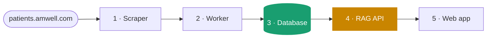
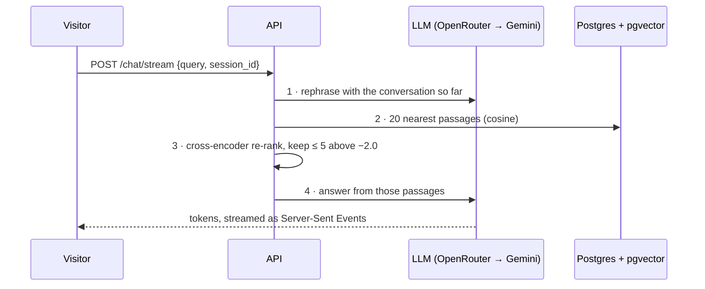

# Medical Chatbot · RAG API

**Stations 3 and 4 of 5** in a data pipeline that turns public health-condition pages into the knowledge behind a chatbot. This repository owns the shared PostgreSQL + pgvector database, and serves the chat that answers questions from it.

▶ **See it explained, with a 3D walkthrough, real re-rank scores and live data:** [/api](https://medicalchatbot.demos.davieldev.com/api) · [/database](https://medicalchatbot.demos.davieldev.com/database) · [try the chat](https://medicalchatbot.demos.davieldev.com/chat)



## One chat turn



| Step on the [API page](https://medicalchatbot.demos.davieldev.com/api) | Code |
| --- | --- |
| 1 · Understand the question | `_rephrase()` in [`app/services/chat.py`](app/services/chat.py), with the prompts in [`app/core/prompts.py`](app/core/prompts.py) |
| 2 · Find similar passages | `search()` in [`app/services/retrieval.py`](app/services/retrieval.py) → `nearest()` in [`app/repositories/documents.py`](app/repositories/documents.py) |
| 3 · Double-check each one | the same `search()`: `TOP_K`, `TOP_N` and `RELEVANCE_THRESHOLD`, charted in [Re-rank scores](https://medicalchatbot.demos.davieldev.com/api#rerank) |
| 4 · Write the answer | `stream_reply()` in [`app/services/chat.py`](app/services/chat.py); OpenRouter with a Gemini fallback in [`app/core/llm.py`](app/core/llm.py) |

Memory is one `chat_history` row per session ([`app/core/memory.py`](app/core/memory.py)). The four tables and how they link are on the [database page](https://medicalchatbot.demos.davieldev.com/database#schema). The API creates them at startup ([`app/core/database.py`](app/core/database.py)), along with the HNSW vector index, and upgrades older databases in place.

## Quick start

```bash
cp .env.example .env     # add OPENROUTER_API_KEY and/or GEMINI_API_KEY
make docker-up           # Postgres + pgvector on :5433, the API on :8001
curl -N -X POST localhost:8001/chat/stream -H 'Content-Type: application/json' \
  -d '{"query": "How is acne treated?", "session_id": "demo"}'
```

To develop with auto-reload, run `make api`: it starts only Postgres in Docker and runs the API with `uv`. `make test` runs the unit tests, which need no database or API keys. The knowledge base comes from the [scraper](https://github.com/davidsanbric-dev/MedicalChatbotScraper) and the [worker](https://github.com/davidsanbric-dev/MedicalChatbotWorker), which write to this Postgres. Interactive docs are at `/docs`.

## Endpoints

| Endpoint | Returns |
| --- | --- |
| `POST /chat/stream` | Server-Sent Events: `{"stage": …}`, `{"token": …}`, then `{"answer": …}`, or `{"error": …}` |
| `POST /chat/` | `{"response": …}`, the same pipeline without streaming |
| `GET /insights/condition-names` | Every condition name |
| `GET /insights/top-symptoms?top_n=10` | `[symptom, number of conditions]` pairs (`top_n` from 1 to 100) |
| `GET /health` | `{"status": "healthy"}` |

Both chat endpoints take `{"query": "...", "session_id": "..."}`. A query is 1 to 1000 characters, and `session_id` keys the conversation's memory; invalid bodies get a `422`. If something fails, visitors get a plain message, and details such as database errors stay in the server log.

## Configuration

| Variable | Default | Purpose |
| --- | --- | --- |
| `DATABASE_URL` | none | Postgres with the pgvector extension available |
| `OPENROUTER_API_KEY` | none | Primary LLM provider; without it, Gemini answers alone |
| `OPENROUTER_MODEL` | `openai/gpt-oss-120b:free` | Must exist on [openrouter.ai/models](https://openrouter.ai/models); free variants come and go |
| `GEMINI_API_KEY`, `GEMINI_MODEL` | none, `gemini-2.5-flash` | Fallback provider, used whenever an OpenRouter call fails |
| `CHAT_RATE_LIMIT_PER_MINUTE`, `CHAT_RATE_LIMIT_PER_DAY` | `6`, `60` | Per-client chat limits (`0` disables) |
| `CHAT_GLOBAL_LIMIT_PER_DAY` | `500` | Chat limit across all clients, which bounds LLM spend |
| `TRUSTED_PROXY_HOPS` | `0` | Reverse proxies in front of the API that append to `X-Forwarded-For` |
| `API_PORT`, `LOG_LEVEL` | `8000`, `INFO` | Server port and log detail |

### Rate limiting behind proxies

Each chat turn costs two LLM calls, so the chat endpoints are rate limited with sliding windows ([`app/core/rate_limit.py`](app/core/rate_limit.py)). A rejected request uses no quota and gets `429` with `Retry-After`. Counters live in process memory: they reset on restart, and several replicas would need a shared store such as Redis.

A client is identified by its address. Behind reverse proxies, that address is the proxy's, so every visitor would share one bucket. To avoid this, set `TRUSTED_PROXY_HOPS` to the number of proxies that append to `X-Forwarded-For`. The client is then read that many entries from the right, so anything a caller forges on the left is ignored.

- **The web app reaches the API over the internal Docker network** (browser → Traefik → nginx → API): set `2`. This is only sound if the API has no shorter public path, since a caller could then pad the header.
- **The web app reaches the API through its public URL**: Traefik replaces the forwarded headers on that second pass, so the API can't tell visitors apart. Keep `0`, and either use the internal URL or set the per-client limits to `0`. The web app's nginx enforces its own per-visitor limits either way.

The global daily cap bounds cost in every setup.

## The whole pipeline

| Station | Repository | Walkthrough |
| --- | --- | --- |
| 1 · Scraper | [MedicalChatbotScraper](https://github.com/davidsanbric-dev/MedicalChatbotScraper) | [/scraper](https://medicalchatbot.demos.davieldev.com/scraper) |
| 2 · Worker | [MedicalChatbotWorker](https://github.com/davidsanbric-dev/MedicalChatbotWorker) | [/worker](https://medicalchatbot.demos.davieldev.com/worker) |
| 3 · Database | **MedicalChatbotAPI** (this one) | [/database](https://medicalchatbot.demos.davieldev.com/database) |
| 4 · RAG API | **MedicalChatbotAPI** (this one) | [/api](https://medicalchatbot.demos.davieldev.com/api) |
| 5 · Web app | [MedicalChatbotWeb](https://github.com/davidsanbric-dev/MedicalChatbotWeb) | [/interface](https://medicalchatbot.demos.davieldev.com/interface) · [chat](https://medicalchatbot.demos.davieldev.com/chat) |

Educational demo: the content comes from a public telehealth site and is not medical advice.
